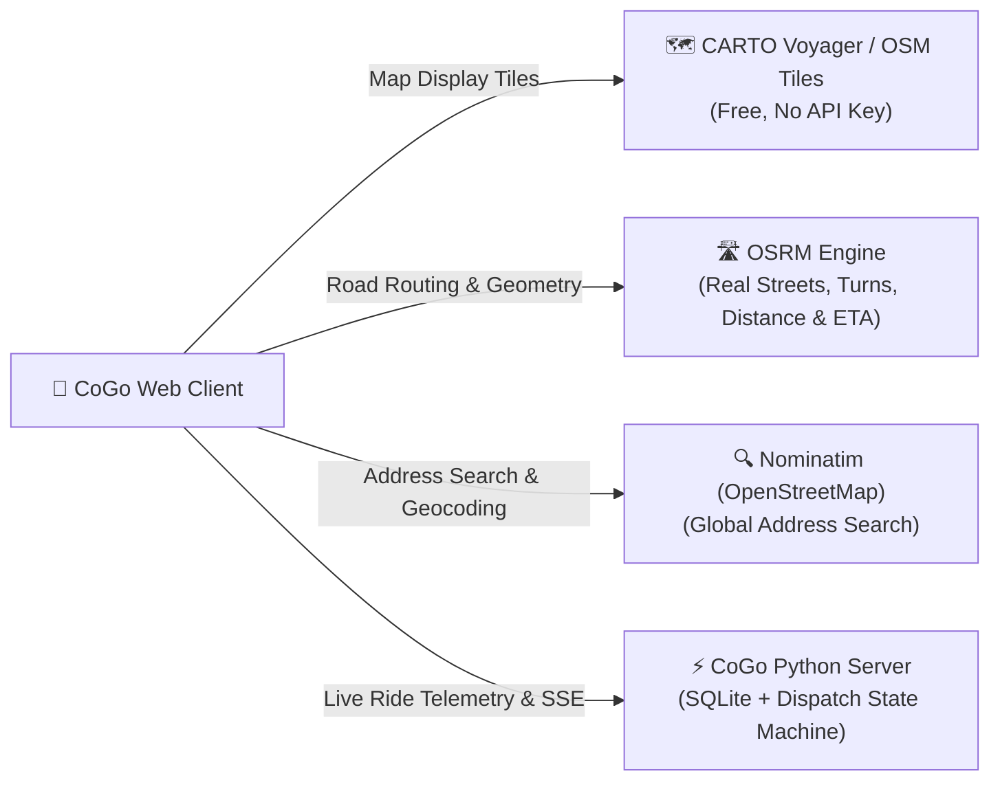

# 🚗 CoGo Mobility — Smarter, Faster Urban Mobility

**CoGo** is a full-featured, real-time ride-hailing and urban mobility platform. Built with a multi-threaded Python backend, interactive web client, and **100% free, open-source map and routing APIs**, CoGo delivers a production-grade ride-hailing experience without requiring credit cards, costly map licenses, or restrictive API keys.

---

## 🗺️ Free & Open-Source Map Engine Architecture

CoGo is architected to operate with **zero map API costs** using the global open-source geospatial ecosystem:



### 1. The Free Geospatial Stack in CoGo

| Layer | Provider / Tool | License / Cost | API Key Needed? | Purpose in CoGo |
| :--- | :--- | :--- | :--- | :--- |
| **Map Rendering & Tiles** | **CARTO Basemaps (Voyager)** | Free CDN / CC-BY | **No** | Provides clean, high-contrast, modern map tiles worldwide. |
| **Road Routing & Geometry** | **OSRM (Open Source Routing Machine)** | BSD / 100% Free | **No** | Computes real road network geometry, driving turns, distances, and ETAs. |
| **Address Search & Geocoding** | **Nominatim (OpenStreetMap)** | ODbL / 100% Free | **No** | Real-time global forward and reverse geocoding for search inputs. |
| **Interactive Map SDK** | **Leaflet.js** | Open Source (BSD-2) | **No** | Lightweight, high-performance web mapping client. |

### 2. OSRM Road Routing API Integration
Instead of crude straight-line calculations, CoGo queries the **OSRM Road Routing Engine**:
- **Endpoint**: `https://router.project-osrm.org/route/v1/driving/{start_lng},{start_lat};{end_lng},{end_lat}?overview=full&geometries=geojson`
- **Output**: Returns road-snapped GeoJSON coordinates (`latlngs`) along actual streets, junctions, and highways, along with exact driving distances (meters) and travel durations (seconds).
- **Graceful Fallback**: If internet connectivity is interrupted, the platform automatically falls back to an urban road detour factor (~1.25x Haversine).

### 3. Self-Hosting OSRM (For Unlimited Production Scale)
For high-volume production deployments with zero external dependencies and zero rate limits, you can self-host OSRM on any server via Docker in minutes:

```bash
# 1. Download OpenStreetMap data for your region (e.g., India or Northern India)
wget http://download.geofabrik.de/asia/india-latest.osm.pbf

# 2. Extract and pre-process road network graph
docker run -t -v "${PWD}:/data" ghcr.io/project-osrm/osrm-backend osrm-extract -p /opt/car.lua /data/india-latest.osm.pbf
docker run -t -v "${PWD}:/data" ghcr.io/project-osrm/osrm-backend osrm-partition /data/india-latest.osrm
docker run -t -v "${PWD}:/data" ghcr.io/project-osrm/osrm-backend osrm-customize /data/india-latest.osrm

# 3. Launch the routing HTTP server
docker run -t -i -p 5000:5000 -v "${PWD}:/data" ghcr.io/project-osrm/osrm-backend osrm-routed --algorithm mld /data/india-latest.osrm
```

### 4. Alternative Generous Free-Tier Providers

If you ever need managed enterprise SLAs without a credit card, you can easily switch to:
- **[Geoapify](https://www.geoapify.com/)**: 3,000 requests/day (90,000/month) free. Covers routing, tiles, and places.
- **[OpenRouteService](https://openrouteservice.org/)**: 2,000 direction requests/day + 1,000 geocodes free.
- **[GraphHopper](https://www.graphhopper.com/)**: 500 routing requests/day free matrix dispatch engine.
- **[MapTiler](https://www.maptiler.com/)**: 100,000 vector tile requests/month free.

---

## 🚘 Real Automotive Fleet & Pricing Tiers

CoGo features 8 real automotive categories with transparent pricing formulas:

| Tier | Vehicle Model | Category | Base Fare | Per Km | Per Min | Capacity & Specs |
| :--- | :--- | :--- | :--- | :--- | :--- | :--- |
| **🛵 CoGo Moto** | Honda Activa 6G / Hero Splendor | Bike Taxi | ₹35 | ₹6.5/km | ₹1.2/min | 1 Rider, Helmet provided, fastest in traffic |
| **🛺 CoGo Auto** | Bajaj Compact 4S (CNG) | Auto Rickshaw | ₹45 | ₹8.5/km | ₹1.8/min | 3 Seats, doorstep pickup, metered value |
| **🚗 CoGo Mini** | Maruti Suzuki WagonR 1.2L DualJet | Compact Hatchback | ₹80 | ₹9.5/km | ₹2.0/min | 4 Seats, AC, affordable daily commute |
| **🚗 CoGo Go** | Maruti Suzuki Swift ZXi | Premium Hatchback | ₹90 | ₹11.0/km | ₹2.2/min | 4 Seats, AC, agile and most popular |
| **🚘 CoGo Sedan** | Maruti Suzuki Dzire VXi / Honda Amaze | Comfort Sedan | ₹110 | ₹13.0/km | ₹2.5/min | 4 Seats, AC, 3 suitcases trunk space |
| **✨ CoGo Premier**| Maruti Suzuki Ciaz Alpha / Hyundai Verna| Executive Sedan | ₹150 | ₹16.0/km | ₹3.0/min | 4 Seats, luxury interior, top-rated captains |
| **🚙 CoGo XL** | Toyota Innova Crysta 2.4 VX | 6-Seater SUV | ₹220 | ₹20.0/km | ₹3.5/min | 6 Seats, group travel & airport runs |
| **⚡ CoGo Green** | Tata Nexon EV Max / MG ZS EV | Electric SUV | ₹120 | ₹13.5/km | ₹2.5/min | 4 Seats, 100% Electric, silent zero emissions |

---

## 🌟 Key Features & Addons

1. **📍 Street-Snapped Routing & Global Place Search**:
   - Real turn-by-turn road geometry with green road polyline.
   - Autocomplete search supporting local Delhi-NCR hubs (Airport T3, Connaught Place, CyberHub, Aerocity) plus worldwide address lookups via Nominatim.
   - Pin-on-map pickers for custom pickup and destination points.

2. **🏷️ Dynamic Coupons & Discounts**:
   - `COGO50`: 50% discount up to ₹100 on any ride.
   - `FIRSTTRIP`: Flat ₹50 discount on your initial booking.
   - `AIRPORT100`: Flat ₹100 discount on long rides (> ₹250).

3. **🧳 Trip Addons & Comfort Options**:
   - **Driver Luggage Assistance**: Captain assists with heavy baggage (+₹30).
   - **Quiet / Silent Ride**: Request a peaceful, conversation-free journey (Free).
   - **Top-Rated Captain Only**: Guaranteed pairing with ★ 4.9+ drivers (+₹25).

4. **💳 Multi-Channel Payment System**:
   - **UPI / QR**: Instant checkout via Google Pay, PhonePe, Paytm, or BHIM.
   - **CoGo Wallet**: In-app wallet with loaded balance (₹500 initial credit).
   - **Cash to Captain**: Traditional cash payment.

5. **📅 Reserve for Later**:
   - Toggle between **⚡ Ride Now** and **📅 Reserve for Later** with a date-time picker.

6. **🚨 Safety Hub & Ride Security**:
   - **Emergency SOS Modal**: Direct one-tap dialer for Police (`112`), Women Helpline (`1091`), and Ambulance (`102`) with live GPS coordinates.
   - **Share Live Trip**: Copies a shareable live tracking link to the clipboard.
   - **🔒 4-Digit Ride Start PIN**: Verifies passenger and prevents boarding the wrong vehicle.

7. **🚖 Interactive Captain Console (Driver Mode)**:
   - Online/Offline duty toggle switch.
   - Incoming ride offers with 15-second countdown and audio chimes synthesized via the **Web Audio API**.
   - Earnings tracker, trip completion metrics, and rating ledger.

8. **💾 Persistent SQLite Database (`cogo_platform.db`)**:
   - All trips, payments, discounts, driver tips, ratings, and feedback are permanently recorded.

---

## 📁 Project Architecture

```
CabBooking-main/
├── app.py                      # Multi-threaded HTTP & Server-Sent Events (SSE) server
├── core/
│   ├── config.py               # Vehicle catalog, driver fleet, landmarks & coupons
│   ├── fare_engine.py          # Haversine distance, travel time & fare formulas
│   ├── dispatch_engine.py      # Nearest driver matching, bearing rotation & state machine
│   └── database.py             # SQLite persistence (trips, ratings, tips, history)
├── static/
│   ├── index.html              # Modern CoGo UI layout (Rider, Captain Console, History)
│   ├── style.css               # CoGo emerald/dark design system & responsive layout
│   └── app.js                  # Leaflet map, OSRM road routing, SSE listener & audio cues
├── cogo_platform.db            # Local SQLite database for persistent storage
├── requirements.txt            # Project dependencies documentation
└── README.md                   # Complete system documentation
```

---

## 🚀 How to Run CoGo

CoGo runs completely on the **Python Standard Library** (Python 3.10+) with **zero pip installs or external dependencies required**:

```bash
# Start the CoGo Mobility server
python app.py
```

Open your browser and navigate to:
```
http://localhost:8000
```
